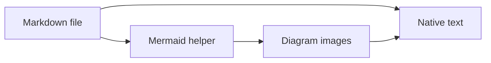
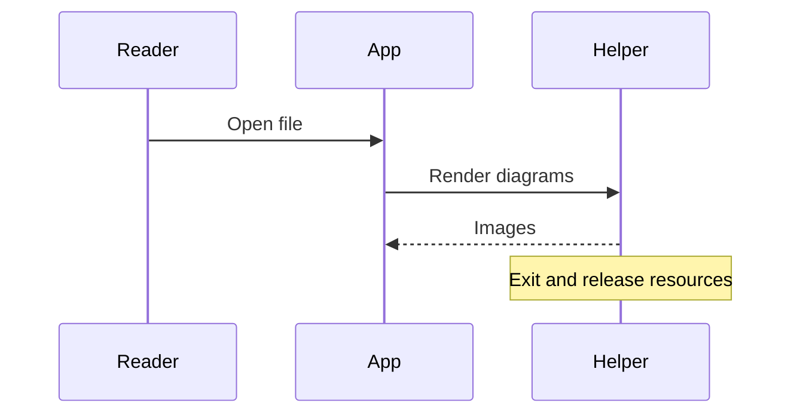

# A small Markdown viewer

Native text, offline Mermaid diagrams, and automatic reload when you save.

## Markdown

Read **bold**, *italic*, ~~struck out~~, and `inline code`. Select text, copy it,
or search with **⌘F**. [Jump to diagrams](#diagrams).

- Compact AppKit interface
- No browser engine for ordinary Markdown
  - Native selection and accessibility
- [x] Offline rendering
- [ ] Your next idea

| Feature | Implementation |
| :--- | :--- |
| Text | AppKit + cmark |
| Diagrams | Temporary Mermaid helper |
| Reload | File system events |

> The renderer closes after producing diagram images.

```swift
let message = "Hello, Markdown"
print(message)
```

## Diagrams





### Local images


Remote images remain as alt text. Raw HTML is shown literally.
